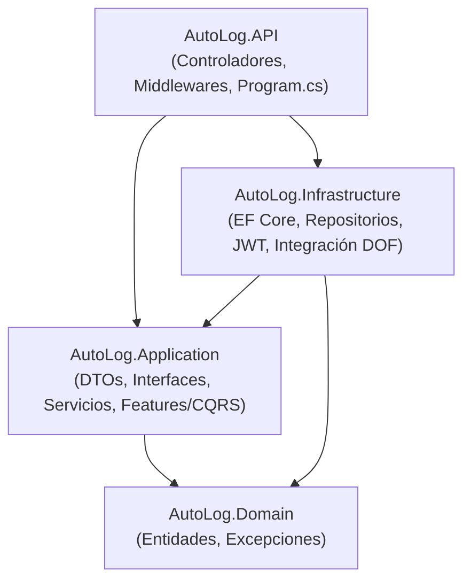
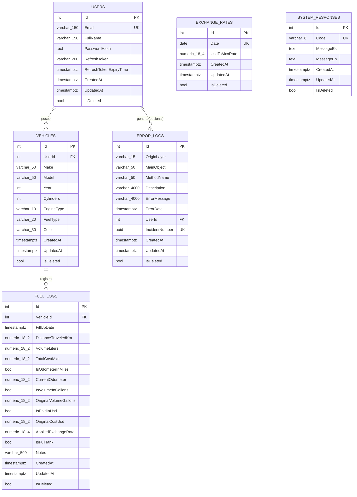
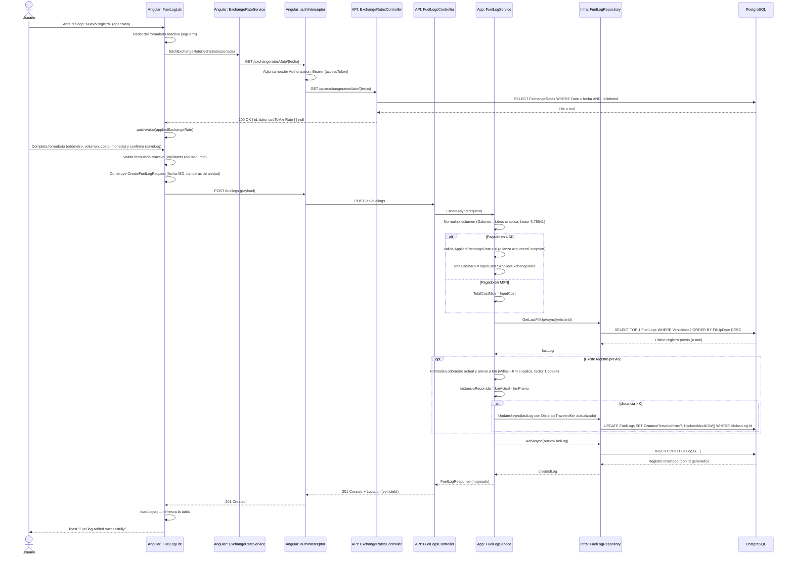
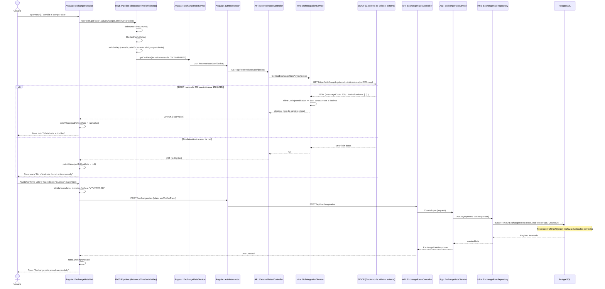
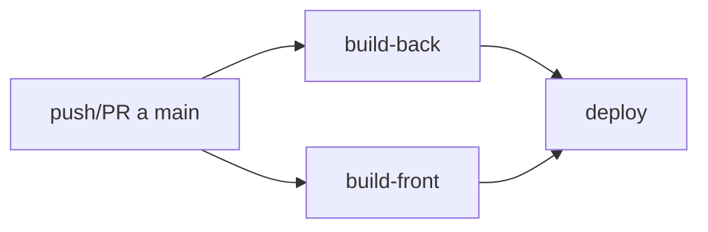

# AUTOLOG — DOCUMENTACIÓN TÉCNICA DE ARQUITECTURA

**Versión del documento:** 1.0
**Fecha de generación:** 2026-08-26
**Alcance:** Backend (.NET 10 / C#), Frontend (Angular ^22, denominado "Angular 20" en la nomenclatura del proyecto), Base de datos (PostgreSQL) e infraestructura de contenedores (Docker, Nginx, GitHub Actions).
**Audiencia:** Desarrolladores humanos y agentes de IA que deban leer, mantener, extender o integrar este sistema.

> **Nota metodológica:** Este documento fue generado mediante un escaneo estático y exhaustivo del código fuente real del repositorio (controladores, entidades, `DbContext`, servicios, interfaces, migraciones, `Dockerfile`, `docker-compose` remoto, workflows de CI/CD y arquitectura del frontend Angular). Toda afirmación aquí contenida está respaldada por una ruta de archivo verificable dentro del repositorio.

---

## Índice

1. [Visión General e Implementación](#1-visión-general-e-implementación)
2. [Arquitectura y Patrones de Diseño](#2-arquitectura-y-patrones-de-diseño)
3. [Estructura de la Base de Datos (PostgreSQL)](#3-estructura-de-la-base-de-datos-postgresql)
4. [Modelado y Diagramas UML](#4-modelado-y-diagramas-uml)
5. [Diccionarios de Datos y Métodos](#5-diccionarios-de-datos-y-métodos)
6. [Consideraciones de Despliegue y Contenedores](#6-consideraciones-de-despliegue-y-contenedores)

---

## 1. Visión General e Implementación

### 1.1. Descripción técnica profunda y propósito de negocio

**AutoLog** es una aplicación web full-stack containerizada cuyo propósito de negocio central es doble:

1. **Bitácora digital de consumo de combustible (Fuel Logging):** permite a un usuario autenticado registrar, por cada vehículo de su propiedad, cada evento de reabastecimiento de combustible («fill-up»), capturando el kilometraje/millaje del odómetro, el volumen cargado (en litros o galones) y el costo total (en MXN o USD). El sistema normaliza automáticamente estas unidades heterogéneas a un estándar interno (kilómetros, litros, pesos mexicanos) para permitir análisis comparables entre registros, incluso si el usuario cambia de unidad de captura entre un registro y otro (por ejemplo, un usuario que cruza la frontera y carga combustible en Estados Unidos en galones y dólares, y en México en litros y pesos).
2. **Gestión de tipos de cambio (Exchange Rate Management):** mantiene un catálogo histórico de tipos de cambio USD→MXN, indexado por fecha única, que se utiliza como insumo para convertir los costos de combustible pagados en dólares a la moneda base del sistema (MXN). Este catálogo puede alimentarse manualmente o mediante sincronización automática con la fuente oficial del gobierno mexicano (Diario Oficial de la Federación, DOF), a través de un servicio de integración externa (`DofIntegrationService`).

El caso de uso originario —explícito en el `README.md` del proyecto— es el seguimiento de gasto y rendimiento de un vehículo (Mustang 2000 V6) por parte de un usuario que vive en una **región fronteriza** y necesita conciliar gastos en dos monedas y dos sistemas de unidades (métrico/imperial). Esto explica decisiones de diseño muy concretas en el dominio, como el almacenamiento simultáneo de:

- El valor **normalizado** (`DistanceTraveledKm`, `VolumeLiters`, `TotalCostMxn`) — usado para reportes y cálculos.
- El valor **original de captura** (`CurrentOdometer`, `OriginalVolumeGallons`, `OriginalCostUsd`, `AppliedExchangeRate`) junto con banderas booleanas (`IsOdometerInMiles`, `IsVolumeInGallons`, `IsPaidInUsd`) — usado para trazabilidad y auditoría del dato tal como lo ingresó el usuario.

Sobre esta base de datos, el sistema calcula KPIs de negocio expuestos a través de un módulo de *Dashboard* (`DashboardService`): rendimiento histórico (km/L), comparativa de eficiencia mensual/anual, gasto mensual acumulado y evolución del tipo de cambio.

### 1.2. Ventajas arquitectónicas del diseño centralizado

El backend está organizado como una **Clean Architecture** de cuatro proyectos .NET independientes (`AutoLog.Domain`, `AutoLog.Application`, `AutoLog.Infrastructure`, `AutoLog.API`), lo cual aporta las siguientes ventajas concretas y verificables en el código:

- **Reusabilidad:** las interfaces de repositorio (`IVehicleRepository`, `IFuelLogRepository`, etc.) y de servicio (`IVehicleService`, `IExchangeRateService`, etc.) están declaradas en `AutoLog.Application`, una capa que **no referencia ningún framework de infraestructura** (ni Entity Framework Core, ni Npgsql). Esto significa que la lógica de negocio (por ejemplo, las conversiones de unidades en `FuelLogService`) podría reutilizarse con un proveedor de persistencia distinto sin modificar una sola línea de la capa de aplicación, siempre que la nueva implementación cumpla el contrato de la interfaz.
- **Mantenibilidad:** el aislamiento estricto de responsabilidades (los controladores en `AutoLog.API` **nunca** acceden directamente a `ApplicationDbContext`; siempre pasan por una interfaz de servicio) permite que un desarrollador modifique la lógica de acceso a datos (`AutoLog.Infrastructure/Repositories/*.cs`) sin arriesgar romper la lógica de negocio o la superficie HTTP.
- **Escalabilidad organizativa:** al estar la solución dividida en proyectos `.csproj` independientes con referencias unidireccionales (`API → Application/Infrastructure → Domain`), es posible que equipos distintos trabajen en paralelo sobre la capa de dominio, la capa de aplicación y la capa de presentación sin colisiones estructurales, y el compilador de C# impone la regla de dependencia (no es posible que `AutoLog.Domain` referencie `AutoLog.Infrastructure`, por ejemplo, porque el `.csproj` de `Domain` no declara esa referencia — ver [AutoLog.Domain.csproj](backend/src/AutoLog.Domain/AutoLog.Domain.csproj)).
- **Independencia de infraestructura:** el `README.md` documenta explícitamente que "no existen secretos hardcodeados en el repositorio; todo se inyecta en tiempo de ejecución vía variables de entorno", lo que se refleja en `Program.cs` (lectura de `ConnectionStrings:DefaultConnection`, `JwtSettings:Secret`, `Cors:AllowedOrigins` desde `IConfiguration`) y en el `entrypoint.sh` del frontend (inyección de `API_URL` en tiempo de arranque del contenedor Nginx, no en tiempo de compilación de Angular).

### 1.3. Guía exhaustiva de importación, instanciación, configuración y uso

Esta sección describe, paso a paso, cómo un desarrollador o un agente de IA debe levantar, configurar y consumir este sistema, ya sea para desarrollo local o para integrarlo como servicio dentro de una infraestructura mayor.

#### 1.3.1. Prerrequisitos

| Componente | Versión mínima | Verificado en |
| :--- | :--- | :--- |
| .NET SDK | 10.0 | [AutoLog.API.csproj](backend/src/AutoLog.API/AutoLog.API.csproj) (`<TargetFramework>net10.0</TargetFramework>`) |
| Node.js | 22.x | [package.json](frontend/package.json) (`"engines": {"node": ">=20.0.0"}`), [Dockerfile](frontend/Dockerfile) (`FROM node:22-alpine`) |
| pnpm | 11.x | [package.json](frontend/package.json), workflow CI |
| PostgreSQL | Compatible con Npgsql 10.0.1 | [AutoLog.Infrastructure.csproj](backend/src/AutoLog.Infrastructure/AutoLog.Infrastructure.csproj) |

#### 1.3.2. Instanciación del backend (`AutoLog.API`)

1. **Restaurar y compilar la solución:**

```bash
cd backend/src
dotnet restore AutoLog.API/AutoLog.API.csproj
dotnet build AutoLog.API/AutoLog.API.csproj
```

2. **Configurar secretos locales** (el proyecto usa `UserSecretsId: b8d8cb12-b048-426f-bc3e-df6b0325d5e7`, ver [AutoLog.API.csproj](backend/src/AutoLog.API/AutoLog.API.csproj)):

```bash
cd backend/src/AutoLog.API
dotnet user-secrets init
dotnet user-secrets set "ConnectionStrings:DefaultConnection" "Host=localhost;Port=5432;Database=AutoLogDb;Username=USER;Password=PASS"
dotnet user-secrets set "JwtSettings:Secret" "CLAVE_LARGA_MIN_32_CARACTERES"
```

Las claves de configuración esperadas (definidas en [appsettings.json](backend/src/AutoLog.API/appsettings.json)) son:

| Clave (`IConfiguration`) | Variable de entorno equivalente (producción) | Propósito |
| :--- | :--- | :--- |
| `ConnectionStrings:DefaultConnection` | `ConnectionStrings__DefaultConnection` | Cadena de conexión Npgsql a PostgreSQL |
| `JwtSettings:Secret` | `JwtSettings__Secret` | Clave simétrica HMAC-SHA256 para firmar/validar JWT (mínimo 32 caracteres) |
| `JwtSettings:Issuer` | `JwtSettings__Issuer` | Emisor del token (`AutoLog.API` por defecto) |
| `JwtSettings:Audience` | `JwtSettings__Audience` | Audiencia del token (`AutoLog.AngularClient` por defecto) |
| `JwtSettings:ExpiryMinutes` | `JwtSettings__ExpiryMinutes` | Minutos de vida del access token (15 por defecto) |
| `JwtSettings:RefreshExpiryDays` | `JwtSettings__RefreshExpiryDays` | Días de vida del refresh token (7 por defecto) |
| `Cors:AllowedOrigins` | `Cors__AllowedOrigins__0`, `__1`, ... | Orígenes permitidos por la política CORS `AllowAngularClient` |

3. **Aplicar migraciones de Entity Framework Core** (ver sección 3 para el detalle de esquema):

```bash
cd backend/src/AutoLog.API
dotnet ef database update --project ../AutoLog.Infrastructure --startup-project .
```

4. **Ejecutar la API:**

```bash
dotnet run --project backend/src/AutoLog.API
```

Al arrancar en modo `Development`, `Program.cs` registra automáticamente el explorador OpenAPI (`app.MapOpenApi()`) y la interfaz Scalar (`app.MapScalarApiReference`) con tema `DeepSpace`, típicamente disponible en `/scalar/v1`.

#### 1.3.3. Instanciación del frontend (`frontend/`)

```bash
cd frontend
pnpm install
pnpm run start   # equivalente a "ng serve"
```

La aplicación queda disponible en `http://localhost:4200`. El archivo [environment.development.ts](frontend/src/environments/environment.development.ts) fija `apiUrl` en `http://localhost:5187/api`, por lo que el backend debe exponerse en ese puerto en desarrollo local (o el desarrollador debe ajustar este valor).

#### 1.3.4. Consumo del API por terceros / agentes de IA

Cualquier cliente HTTP externo debe seguir el siguiente flujo de integración:

1. Registrar un usuario: `POST /api/auth/register`.
2. Autenticarse: `POST /api/auth/login`, obteniendo un par `{accessToken, refreshToken}`.
3. Adjuntar el `accessToken` en el header `Authorization: Bearer <token>` en **todas** las peticiones subsecuentes a los endpoints protegidos (todos excepto `/api/auth/*`).
4. Cuando el `accessToken` expira (respuesta `401`), invocar `POST /api/auth/refresh` con el par de tokens vencido/vigente para obtener un nuevo par, y reintentar la petición original. Este es exactamente el comportamiento implementado en el interceptor Angular ([auth.interceptor.ts](frontend/src/app/core/interceptors/auth.interceptor.ts)) y debe ser replicado por cualquier consumidor programático.
5. Todas las rutas de escritura sobre `Vehicles` y `FuelLogs` derivan implícitamente el `UserId` del *claim* `ClaimTypes.NameIdentifier` del JWT (ver `GetCurrentUserId()` en [VehiclesController.cs](backend/src/AutoLog.API/Controllers/VehiclesController.cs)); **no existe** manera de operar sobre vehículos o bitácoras de otro usuario, incluso si se conoce su `id` numérico (control de propiedad a nivel de repositorio, ver sección 2.4).

---

## 2. Arquitectura y Patrones de Diseño

### 2.1. Estilo arquitectónico general

El backend implementa una variante de **Clean Architecture / Arquitectura en Capas (N-Tier) con principios de Domain-Driven Design (DDD) ligero**, organizada en cuatro proyectos con dependencias unidireccionales estrictas:



Esta disposición corresponde al **"Modular Monolith"** que el propio `README.md` declara: un único proceso desplegable (`AutoLog.API.dll`) internamente modularizado por capas y por *features*, en lugar de una arquitectura de microservicios.

El frontend, por su parte, sigue la arquitectura recomendada moderna de **Angular Standalone Components** (sin `NgModule`), organizada por *feature folders* (`features/auth`, `features/dashboard`, `features/vehicles`, `features/fuel-logs`, `features/exchange-rates`) más una capa transversal `core/` (guards, interceptores, modelos, servicios, UI compartida) y una capa `layout/` para el *shell* visual protegido.

### 2.2. Inventario y justificación de patrones de diseño detectados

| Patrón | Evidencia concreta en el código | Justificación de la implementación |
| :--- | :--- | :--- |
| **Repository Pattern** | `IUserRepository`/`UserRepository`, `IVehicleRepository`/`VehicleRepository`, `IFuelLogRepository`/`FuelLogRepository`, `IExchangeRateRepository`/`ExchangeRateRepository` ([backend/src/AutoLog.Infrastructure/Repositories](backend/src/AutoLog.Infrastructure/Repositories)) | Desacopla la capa de Aplicación del ORM concreto (EF Core). Las interfaces viven en `AutoLog.Application.Interfaces.Repositories`; las implementaciones concretas —que sí conocen `ApplicationDbContext` y LINQ-to-Entities— viven exclusivamente en `AutoLog.Infrastructure`. |
| **Dependency Injection (DI) / Inversion of Control** | Todo el árbol de dependencias se registra en [Program.cs](backend/src/AutoLog.API/Program.cs) mediante `builder.Services.AddScoped<TInterface, TImpl>()` | Es el mecanismo nativo de ASP.NET Core. Todas las clases de servicio, repositorio y el propio `ApplicationDbContext` se inyectan por constructor (primary constructors de C# 12, ej. `public class UserRepository(ApplicationDbContext dbContext) : IUserRepository`), habilitando *testability* mediante mocks de las interfaces. |
| **CQRS (Command Query Responsibility Segregation) — aplicado parcialmente** | Carpeta [Features/Auth/Commands](backend/src/AutoLog.Application/Features/Auth/Commands) con `LoginUserCommand`, `RegisterUserCommand`, `RefreshTokenCommand`, cada uno como `record` que implementa `IRequest<TResponse>` de **MediatR**, resuelto por un `Handler` dedicado (`LoginUserCommandHandler`, etc.) | El módulo de autenticación es el **único** módulo que usa el patrón CQRS explícito vía MediatR (`builder.Services.AddMediatR(...)` en `Program.cs`, escaneando el assembly de `AutoLog.Application`). El resto de los módulos (`Vehicles`, `FuelLogs`, `ExchangeRates`, `Dashboard`) usa un patrón de **Service Layer clásico** (interfaz de servicio + implementación inyectada directamente en el controlador), sin *Commands*/*Queries* de MediatR. Esto constituye una arquitectura **híbrida intencional**: CQRS-lite sólo donde el flujo transaccional lo justifica (login/registro/refresco, que involucran generación de tokens y actualización de estado de sesión), y Service Layer simple para operaciones CRUD estándar. |
| **Adapter Pattern (integración externa)** | `IDofIntegrationService` / `DofIntegrationService` ([backend/src/AutoLog.Infrastructure/Integrations/DOF](backend/src/AutoLog.Infrastructure/Integrations/DOF)) | Adapta la API pública del Diario Oficial de la Federación (`https://sidof.segob.gob.mx/dof/sidof/indicadores/`), con su formato de fecha `dd-MM-yyyy` y su esquema JSON propietario (`DofResponse`/`DofIndicator`), a un contrato simple del dominio: `Task<decimal?> GetUsdExchangeRateAsync(DateTime date)`. Los consumidores internos (el controlador `ExternalRatesController`) no conocen ni el formato ni el proveedor externo. |
| **DTO (Data Transfer Object) Pattern** | Carpeta completa [AutoLog.Application/DTOs](backend/src/AutoLog.Application/DTOs) (`CreateVehicleDto`, `VehicleResponseDto`, `CreateFuelLogRequest`, `FuelLogResponse`, etc.) | Ninguna entidad de dominio (`Vehicle`, `FuelLog`, `User`, etc.) se serializa directamente hacia el cliente HTTP. Cada servicio de aplicación realiza un mapeo manual explícito Entidad↔DTO (sin AutoMapper; el mapeo se escribe a mano en cada método, ej. `VehicleService.GetAllVehiclesAsync`), lo que evita fugas de propiedades internas (como `PasswordHash` o `IsDeleted`) hacia el contrato público. |
| **Middleware Pattern / Chain of Responsibility** | `GlobalExceptionHandler : IExceptionHandler` registrado con `builder.Services.AddExceptionHandler<GlobalExceptionHandler>()` y activado con `app.UseExceptionHandler()` | Centraliza el manejo de errores de **toda** la tubería HTTP en un único punto, que además persiste el error en la tabla `ErrorLogs` y devuelve un contrato `ProblemDetails` estandarizado (RFC 7807) enriquecido con `errorCode` e `incidentNumber`. |
| **Custom Exception / Controlled Business Error Pattern** | `CustomAppException : Exception` con propiedad `ErrorCode` ([backend/src/AutoLog.Domain/Exceptions/CustomAppException.cs](backend/src/AutoLog.Domain/Exceptions/CustomAppException.cs)) | Permite distinguir, dentro del `GlobalExceptionHandler`, entre errores de negocio controlados (HTTP 400, título "Business Rule Violation") y errores no controlados/de infraestructura (HTTP 500). Los `ErrorCode` (`ERR401`, `e00400`, `e00401`) están pensados para mapear contra la tabla catálogo `SystemResponses` (mensajes bilingües ES/EN), aunque **actualmente ningún componente del código consulta dicha tabla en tiempo de ejecución** — es una infraestructura de i18n de errores preparada pero no conectada todavía (ver observación en sección 3.3). |
| **Soft Delete Pattern** | Propiedad `IsDeleted` en `BaseEntity`, filtrada explícitamente en cada consulta de repositorio (ej. `Where(v => v.UserId == userId && !v.IsDeleted)` en `VehicleRepository.GetVehiclesByUserIdAsync`) | Ninguna operación de "eliminación" ejecuta un `DELETE` SQL real sobre `Vehicles`, `FuelLogs` o `ExchangeRates`; en su lugar, el repositorio marca `IsDeleted = true` y actualiza el registro (`DeleteAsync` en cada repositorio). Esto preserva el historial para auditoría/recuperación, a costa de requerir que **toda** consulta futura incluya el filtro `!IsDeleted` manualmente (no se usa un *Global Query Filter* de EF Core para esto, ver observación en 2.4). |
| **Template Method (implícito) / Auditoría automática** | `ApplicationDbContext.SaveChangesAsync` sobrescrito para poblar `CreatedAt`/`UpdatedAt` de cualquier entidad `BaseEntity` en estado `Added`/`Modified`, antes de delegar en `base.SaveChangesAsync()` | Centraliza la lógica de *timestamps* de auditoría en un único punto (el `DbContext`), evitando que cada repositorio tenga que fijar manualmente `CreatedAt`/`UpdatedAt` (aunque, de forma inconsistente, algunos repositorios como `FuelLogRepository` y `ExchangeRateRepository` **también** fijan estos campos manualmente de forma redundante antes de llamar a `SaveChangesAsync`). |
| **Facade / Barrel Export (frontend)** | [primeng-imports.ts](frontend/src/app/core/shared/ui/primeng-imports.ts) exporta arreglos constantes (`PRIME_AUTH_IMPORTS`, `PRIME_FUEL_IMPORTS`, `DASHBOARD_IMPORTS`, etc.) que agrupan los módulos standalone de PrimeNG necesarios por *feature* | Evita que cada componente standalone liste manualmente 5–10 imports de PrimeNG en su decorador `@Component`; centraliza el catálogo de UI-kit por dominio funcional. |
| **Functional Guards / Interceptors (Angular)** | `authGuard: CanActivateFn` ([auth-guard.ts](frontend/src/app/core/guards/auth-guard.ts)), `authInterceptor: HttpInterceptorFn` ([auth.interceptor.ts](frontend/src/app/core/interceptors/auth.interceptor.ts)) | Angular moderno (v14+) reemplaza las clases `CanActivate`/`HttpInterceptor` por funciones puras inyectables vía `inject()`, registradas declarativamente en `app.config.ts` (`provideHttpClient(withInterceptors([authInterceptor]))`) y en `app.routes.ts` (`canActivate: [authGuard]`). |
| **Reactive Forms + Observable Pipeline (frontend)** | `ExchangeRateList.setupDofListener()` encadena `debounceTime(300) → filter → switchMap` sobre `rateForm.get('date').valueChanges` para sincronizar automáticamente el tipo de cambio oficial del DOF cada vez que el usuario cambia la fecha en el formulario | Patrón reactivo idiomático de RxJS: evita disparar una petición HTTP por cada tecla/click, cancela peticiones obsoletas (`switchMap`) si el usuario cambia la fecha nuevamente antes de que responda la anterior, y absorbe errores de red sin romper el stream (`catchError(() => of(null))`). |

### 2.3. Flujo de autenticación y autorización

El sistema usa **JWT (JSON Web Tokens) con esquema de Access Token + Refresh Token**:

- El **Access Token** es un JWT firmado con `HmacSha256` (`SymmetricSecurityKey` derivada de `JwtSettings:Secret`), con claims `sub` (Id de usuario), `email`, `name` (nombre completo) y un claim custom `"UserId"` (usado específicamente por `GlobalExceptionHandler` y `RefreshTokenCommandHandler` para extraer la identidad sin depender del mapeo automático de claims de ASP.NET Core). Expira en `JwtSettings:ExpiryMinutes` (15 min por defecto).
- El **Refresh Token** es un valor aleatorio criptográficamente seguro de 64 bytes (`RandomNumberGenerator.Create()`), codificado en Base64, **persistido en la tabla `Users`** (columnas `RefreshToken`, `RefreshTokenExpiryTime`, añadidas por la migración `AddRefreshTokenToUser`). Expira en `JwtSettings:RefreshExpiryDays` (7 días por defecto).
- La validación de un token expirado durante el flujo de *refresh* (`JwtService.GetPrincipalFromExpiredToken`) se realiza con `ValidateLifetime = false` deliberadamente, para poder leer los claims de un token técnicamente vencido, pero **sí** se valida estrictamente el algoritmo de firma (`HmacSha256`) para prevenir ataques de tipo *"alg: none"* o *downgrade*.
- Todos los controladores de negocio (`VehiclesController`, `FuelLogsController`, `ExchangeRatesController`, `ExternalRatesController`, `DashboardController`) están decorados con `[Authorize]`, delegando la validación del *Bearer token* al middleware `app.UseAuthentication()` + `app.UseAuthorization()` configurado en `Program.cs` mediante `AddJwtBearer`.

### 2.4. Observaciones arquitectónicas relevantes (para mantenimiento futuro)

Estas observaciones no son errores bloqueantes, pero son relevantes para cualquier agente que extienda el sistema:

1. **Ausencia de Global Query Filter para Soft Delete:** EF Core permite declarar `modelBuilder.Entity<T>().HasQueryFilter(e => !e.IsDeleted)` para que el filtro se aplique automáticamente a *toda* consulta LINQ sobre esa entidad. Este proyecto **no** usa esa característica; el filtro `!IsDeleted` se repite manualmente en cada método de cada repositorio. Un nuevo método de repositorio que olvide este filtro expondría silenciosamente registros "eliminados".
2. **`SystemResponses` es un catálogo no conectado:** la entidad y tabla existen, con índice único sobre `Code`, pero ningún repositorio, servicio o controlador la consulta. Los `ErrorCode` de `CustomAppException` (`"ERR401"`, `"e00400"`, `"e00401"`, `"e00000"`) se usan como literales de cadena, no como claves foráneas resueltas contra esta tabla.
3. **Actualización retroactiva de distancia en `FuelLogService.CreateAsync`:** al crear un nuevo registro de combustible, el servicio localiza el **último** registro previo del mismo vehículo (`GetLastFillUpAsync`) y le **actualiza** su `DistanceTraveledKm` calculando la diferencia de odómetro entre ambos registros. Esto implica que la distancia recorrida asociada a un `FuelLog` representa la distancia recorrida **desde ese registro hasta el siguiente**, no desde el registro anterior hasta éste. Cualquier lógica de reportes debe respetar esta semántica.
4. **`FuelLogService.UpdateAsync` no recalcula distancias:** el propio comentario en el código lo advierte — una actualización sólo toca `FillUpDate`, `IsFullTank` y `Notes`; si se editara el odómetro de un registro histórico, la cadena de distancias entre registros adyacentes quedaría desincronizada.
5. **Discrepancia de versión de Angular:** el `README.md` y la nomenclatura del proyecto refieren "Angular 20", pero [package.json](frontend/package.json) fija `"@angular/core": "^22.0.5"`. Se documenta aquí la versión realmente instalada para evitar confusión.
6. **Discrepancia entre imágenes Docker del `README.md` y del CI/CD real:** el `README.md` documenta imágenes en Docker Hub (`julioreynadev/autolog-api`, `julioreyna/autolog-web`), mientras que el workflow real [deploy.yml](.github/workflows/deploy.yml) publica en **GitHub Container Registry** (`ghcr.io/jreyna217/autolog-api`, `ghcr.io/jreyna217/autolog-web`). Un agente que automatice despliegues debe usar el registro real del CI (`ghcr.io`), no el documentado en el README.

---

## 3. Estructura de la Base de Datos (PostgreSQL)

### 3.1. Motor y estrategia de acceso a datos

- **Motor:** PostgreSQL, accedido mediante el proveedor `Npgsql.EntityFrameworkCore.PostgreSQL` (v10.0.1).
- **Estrategia:** *Code-First* con Entity Framework Core — el esquema se define en clases C# (`AutoLog.Domain.Entities`) y se versiona mediante migraciones (`AutoLog.Infrastructure/Data/Migrations`).
- **Migraciones existentes:**
  1. `20260328032801_InitialCreate` — crea las 6 tablas base con todos sus índices y llaves foráneas.
  2. `20260330015050_AddRefreshTokenToUser` — añade `RefreshToken` (varchar 200, nullable) y `RefreshTokenExpiryTime` (timestamptz, nullable) a `Users`.
- **Convención de claves primarias:** todas las tablas usan `Id` (`integer`, `GENERATED BY DEFAULT AS IDENTITY` vía `NpgsqlValueGenerationStrategy.IdentityByDefaultColumn`).
- **Convención de auditoría:** todas las tablas heredan de `BaseEntity` y por tanto incluyen `CreatedAt` (`timestamp with time zone`, NOT NULL), `UpdatedAt` (`timestamp with time zone`, NULL) e `IsDeleted` (`boolean`, NOT NULL, default `false`).

### 3.2. Descripción tabla por tabla

#### 3.2.1. `Users`

| Columna | Tipo PostgreSQL | Nulo | Restricciones | Descripción |
| :--- | :--- | :--- | :--- | :--- |
| `Id` | `integer` | No | PK, Identity | Identificador único del usuario |
| `Email` | `character varying(150)` | No | **Índice único** (`IX_Users_Email`) | Correo electrónico, usado como *login* |
| `FullName` | `character varying(150)` | No | — | Nombre completo (anotado con `[EmailAddress]` en la entidad, aparente inconsistencia de validación heredada, ver 5.1) |
| `PasswordHash` | `text` | No | — | Hash BCrypt de la contraseña (nunca se persiste texto plano) |
| `RefreshToken` | `character varying(200)` | Sí | — | Token de refresco vigente más reciente |
| `RefreshTokenExpiryTime` | `timestamp with time zone` | Sí | — | Expiración del refresh token |
| `CreatedAt` / `UpdatedAt` / `IsDeleted` | — | — | — | Columnas de auditoría heredadas de `BaseEntity` |

#### 3.2.2. `Vehicles`

| Columna | Tipo PostgreSQL | Nulo | Restricciones | Descripción |
| :--- | :--- | :--- | :--- | :--- |
| `Id` | `integer` | No | PK, Identity | Identificador único del vehículo |
| `UserId` | `integer` | No | **FK → `Users.Id`**, `ON DELETE CASCADE`, índice `IX_Vehicles_UserId` | Propietario del vehículo |
| `Make` | `character varying(50)` | No | — | Marca (ej. "Ford") |
| `Model` | `character varying(50)` | No | — | Modelo (ej. "Mustang") |
| `Year` | `integer` | No | — | Año del modelo |
| `Cylinders` | `integer` | No | — | Número de cilindros |
| `EngineType` | `character varying(10)` | No | — | Tipo de motor (ej. "3.7 V6") |
| `FuelType` | `character varying(20)` | No | — | Tipo de combustible (ej. "Gasoline") |
| `Color` | `character varying(30)` | Sí | — | Color del vehículo |
| `CreatedAt` / `UpdatedAt` / `IsDeleted` | — | — | — | Auditoría / soft-delete |

#### 3.2.3. `FuelLogs`

| Columna | Tipo PostgreSQL | Nulo | Restricciones | Descripción |
| :--- | :--- | :--- | :--- | :--- |
| `Id` | `integer` | No | PK, Identity | Identificador único del registro |
| `VehicleId` | `integer` | No | **FK → `Vehicles.Id`**, `ON DELETE CASCADE`, índice `IX_FuelLogs_VehicleId` | Vehículo asociado |
| `FillUpDate` | `timestamp with time zone` | No | — | Fecha/hora del reabastecimiento |
| `DistanceTraveledKm` | `numeric(18,2)` | No | — | Distancia normalizada en km (calculada retroactivamente, ver 2.4.3) |
| `VolumeLiters` | `numeric(18,2)` | No | — | Volumen normalizado en litros |
| `TotalCostMxn` | `numeric(18,2)` | No | — | Costo normalizado en MXN |
| `IsOdometerInMiles` | `boolean` | No | — | Bandera: el odómetro se capturó en millas |
| `CurrentOdometer` | `numeric(18,2)` | No | — | Lectura de odómetro tal como se capturó (unidad original) |
| `IsVolumeInGallons` | `boolean` | No | — | Bandera: el volumen se capturó en galones |
| `OriginalVolumeGallons` | `numeric(18,2)` | Sí | — | Volumen original en galones (si aplica) |
| `IsPaidInUsd` | `boolean` | No | — | Bandera: el pago se realizó en USD |
| `OriginalCostUsd` | `numeric(18,2)` | Sí | — | Costo original en USD (si aplica) |
| `AppliedExchangeRate` | `numeric(18,4)` | Sí | — | Tipo de cambio aplicado en la conversión USD→MXN |
| `IsFullTank` | `boolean` | No | — | Indica si fue un llenado completo del tanque (relevante para cálculos de rendimiento) |
| `Notes` | `character varying(500)` | Sí | — | Notas libres del usuario |
| `CreatedAt` / `UpdatedAt` / `IsDeleted` | — | — | — | Auditoría / soft-delete |

#### 3.2.4. `ExchangeRates`

| Columna | Tipo PostgreSQL | Nulo | Restricciones | Descripción |
| :--- | :--- | :--- | :--- | :--- |
| `Id` | `integer` | No | PK, Identity | Identificador único |
| `Date` | `date` | No | **Índice único** (`IX_ExchangeRates_Date`) | Fecha del tipo de cambio (garantiza un único valor por día) |
| `UsdToMxnRate` | `numeric(18,4)` | No | `Range(0.01, 100.00)` a nivel DTO | Valor del dólar en pesos mexicanos |
| `CreatedAt` / `UpdatedAt` / `IsDeleted` | — | — | — | Auditoría / soft-delete |

#### 3.2.5. `ErrorLogs`

| Columna | Tipo PostgreSQL | Nulo | Restricciones | Descripción |
| :--- | :--- | :--- | :--- | :--- |
| `Id` | `integer` | No | PK, Identity | Identificador único |
| `OriginLayer` | `character varying(15)` | No | — | Capa de origen del error (ej. "API") |
| `MainObject` | `character varying(50)` | No | — | Objeto principal afectado (en la práctica, la ruta HTTP, ver `GlobalExceptionHandler`) |
| `MethodName` | `character varying(50)` | No | — | Método afectado (en la práctica, el verbo HTTP) |
| `Description` | `character varying(4000)` | Sí | — | Descripción adicional (mensaje de la excepción interna) |
| `ErrorMessage` | `character varying(4000)` | No | — | Mensaje de la excepción |
| `ErrorDate` | `timestamp with time zone` | No | — | Fecha del error (default `DateTime.UtcNow` a nivel de entidad) |
| `UserId` | `integer` | Sí | **FK → `Users.Id`** (sin acción explícita; comportamiento por defecto de EF Core para relación opcional), índice `IX_ErrorLogs_UserId` | Usuario autenticado en el momento del error, si existe |
| `IncidentNumber` | `uuid` | No | **Índice único** (`IX_ErrorLogs_IncidentNumber`) | Identificador de incidente devuelto al cliente para soporte/trazabilidad |
| `CreatedAt` / `UpdatedAt` / `IsDeleted` | — | — | — | Auditoría / soft-delete |

#### 3.2.6. `SystemResponses`

| Columna | Tipo PostgreSQL | Nulo | Restricciones | Descripción |
| :--- | :--- | :--- | :--- | :--- |
| `Id` | `integer` | No | PK, Identity | Identificador único |
| `Code` | `character varying(6)` | No | **Índice único** (`IX_SystemResponses_Code`) | Código corto de respuesta/error (ej. futuro mapeo de `ERR401`) |
| `MessageEs` | `text` | No | — | Mensaje en español |
| `MessageEn` | `text` | No | — | Mensaje en inglés |
| `CreatedAt` / `UpdatedAt` / `IsDeleted` | — | — | — | Auditoría / soft-delete |

> Ver observación 2.4.2: esta tabla está definida en el esquema pero no es consultada por ningún componente de negocio actual.

### 3.3. Diagrama Entidad-Relación (ERD)



> **Nota:** `EXCHANGE_RATES` y `SYSTEM_RESPONSES` son catálogos independientes, sin llave foránea entrante ni saliente hacia el resto del modelo; su relación con `FUEL_LOGS` (el tipo de cambio aplicado) es **funcional/aplicativa** (se resuelve en tiempo de ejecución en `FuelLogService.CreateAsync` mediante el valor `AppliedExchangeRate` capturado del formulario, no mediante una FK real a `ExchangeRates.Id`).

---

## 4. Modelado y Diagramas UML

### 4.1. Diagrama de Clases UML

El siguiente diagrama consolida las entidades de dominio, las interfaces de repositorio y servicio, sus implementaciones concretas, y los *handlers* de comandos MediatR del módulo de autenticación.

```mermaid
classDiagram
    class BaseEntity {
        <<abstract>>
        +int Id
        +DateTime CreatedAt
        +DateTime? UpdatedAt
        +bool IsDeleted
    }

    class User {
        +string Email
        +string FullName
        +string PasswordHash
        +string? RefreshToken
        +DateTime? RefreshTokenExpiryTime
        +ICollection~Vehicle~ Vehicles
        +ICollection~ErrorLog~ ErrorLogs
    }

    class Vehicle {
        +int UserId
        +User User
        +string Make
        +string Model
        +int Year
        +int Cylinders
        +string EngineType
        +string FuelType
        +string? Color
        +ICollection~FuelLog~ FuelLogs
    }

    class FuelLog {
        +int VehicleId
        +Vehicle Vehicle
        +DateTime FillUpDate
        +decimal DistanceTraveledKm
        +decimal VolumeLiters
        +decimal TotalCostMxn
        +bool IsOdometerInMiles
        +decimal CurrentOdometer
        +bool IsVolumeInGallons
        +decimal? OriginalVolumeGallons
        +bool IsPaidInUsd
        +decimal? OriginalCostUsd
        +decimal? AppliedExchangeRate
        +bool IsFullTank
        +string? Notes
    }

    class ExchangeRate {
        +DateOnly Date
        +decimal UsdToMxnRate
    }

    class ErrorLog {
        +string OriginLayer
        +string MainObject
        +string MethodName
        +string? Description
        +string ErrorMessage
        +DateTime ErrorDate
        +int? UserId
        +User? User
        +Guid IncidentNumber
    }

    class SystemResponse {
        +string Code
        +string MessageEs
        +string MessageEn
    }

    class CustomAppException {
        +string ErrorCode
    }

    BaseEntity <|-- User
    BaseEntity <|-- Vehicle
    BaseEntity <|-- FuelLog
    BaseEntity <|-- ExchangeRate
    BaseEntity <|-- ErrorLog
    BaseEntity <|-- SystemResponse
    User "1" --> "0..*" Vehicle
    User "1" --> "0..*" ErrorLog
    Vehicle "1" --> "0..*" FuelLog
    Exception <|-- CustomAppException

    class IUserRepository {
        <<interface>>
        +ExistsByEmailAsync(email) Task~bool~
        +GetByEmailAsync(email) Task~User?~
        +GetByIdAsync(id) Task~User?~
        +AddAsync(user) Task
        +UpdateAsync(user) Task
    }
    class UserRepository {
        -ApplicationDbContext dbContext
    }
    IUserRepository <|.. UserRepository

    class IVehicleRepository {
        <<interface>>
        +GetVehiclesByUserIdAsync(userId) Task~IEnumerable~Vehicle~~
        +GetVehicleByIdAsync(id, userId) Task~Vehicle?~
        +AddAsync(vehicle) Task~Vehicle~
        +UpdateAsync(vehicle) Task
        +DeleteAsync(vehicle) Task
    }
    class VehicleRepository {
        -ApplicationDbContext _context
    }
    IVehicleRepository <|.. VehicleRepository

    class IFuelLogRepository {
        <<interface>>
        +GetAllByVehicleIdAsync(vehicleId) Task~IEnumerable~FuelLog~~
        +GetByIdAsync(id) Task~FuelLog?~
        +GetLastFillUpAsync(vehicleId) Task~FuelLog?~
        +AddAsync(fuelLog) Task~FuelLog~
        +UpdateAsync(fuelLog) Task
        +DeleteAsync(fuelLog) Task
    }
    class FuelLogRepository {
        -ApplicationDbContext _context
    }
    IFuelLogRepository <|.. FuelLogRepository

    class IExchangeRateRepository {
        <<interface>>
        +GetAllAsync() Task~IEnumerable~ExchangeRate~~
        +GetByIdAsync(id) Task~ExchangeRate?~
        +AddAsync(rate) Task~ExchangeRate~
        +UpdateAsync(rate) Task
        +DeleteAsync(rate) Task
        +GetByDateAsync(date) Task~ExchangeRate?~
    }
    class ExchangeRateRepository {
        -ApplicationDbContext _context
    }
    IExchangeRateRepository <|.. ExchangeRateRepository

    class IVehicleService {
        <<interface>>
        +GetAllVehiclesAsync(userId) Task~IEnumerable~VehicleResponseDto~~
        +GetVehicleByIdAsync(id, userId) Task~VehicleResponseDto~
        +CreateVehicleAsync(userId, dto) Task~VehicleResponseDto~
        +UpdateVehicleAsync(id, userId, dto) Task
        +DeleteVehicleAsync(id, userId) Task
    }
    class VehicleService {
        -IVehicleRepository _vehicleRepository
    }
    IVehicleService <|.. VehicleService
    VehicleService --> IVehicleRepository

    class IFuelLogService {
        <<interface>>
        +GetAllByVehicleIdAsync(vehicleId) Task~IEnumerable~FuelLogResponse~~
        +CreateAsync(request) Task~FuelLogResponse~
        +UpdateAsync(id, request) Task
        +DeleteAsync(id) Task
    }
    class FuelLogService {
        -IFuelLogRepository _repository
        -const decimal MilesToKm
        -const decimal GallonsToLiters
    }
    IFuelLogService <|.. FuelLogService
    FuelLogService --> IFuelLogRepository

    class IExchangeRateService {
        <<interface>>
        +GetAllAsync() Task~IEnumerable~ExchangeRateResponse~~
        +CreateAsync(request) Task~ExchangeRateResponse~
        +UpdateAsync(id, request) Task
        +DeleteAsync(id) Task
        +GetByDateAsync(date) Task~ExchangeRateResponse?~
    }
    class ExchangeRateService {
        -IExchangeRateRepository _repository
    }
    IExchangeRateService <|.. ExchangeRateService
    ExchangeRateService --> IExchangeRateRepository

    class IDashboardService {
        <<interface>>
        +GetSummaryAsync(userId, vehicleId, month, year) Task~DashboardSummaryResponse~
    }
    class DashboardService {
        -IVehicleRepository _vehicleRepo
        -IFuelLogRepository _fuelRepo
        -IExchangeRateRepository _exchangeRepo
    }
    IDashboardService <|.. DashboardService
    DashboardService --> IVehicleRepository
    DashboardService --> IFuelLogRepository
    DashboardService --> IExchangeRateRepository

    class IJwtService {
        <<interface>>
        +GenerateAccessToken(user) string
        +GenerateRefreshToken() string
        +GetPrincipalFromExpiredToken(token) ClaimsPrincipal
    }
    class JwtService {
        -IConfiguration configuration
    }
    IJwtService <|.. JwtService

    class IDofIntegrationService {
        <<interface>>
        +GetUsdExchangeRateAsync(date) Task~decimal?~
    }
    class DofIntegrationService {
        -HttpClient _httpClient
    }
    IDofIntegrationService <|.. DofIntegrationService

    class LoginUserCommandHandler {
        +Handle(command) Task~TokenResponseDto~
    }
    class RegisterUserCommandHandler {
        +Handle(command) Task~bool~
    }
    class RefreshTokenCommandHandler {
        +Handle(command) Task~TokenResponseDto~
    }
    LoginUserCommandHandler --> IUserRepository
    LoginUserCommandHandler --> IJwtService
    RegisterUserCommandHandler --> IUserRepository
    RefreshTokenCommandHandler --> IUserRepository
    RefreshTokenCommandHandler --> IJwtService
```



### 4.2. Diagrama de Secuencia #1 — Ciclo de vida completo del registro de un evento de combustible

Este diagrama traza el flujo real desde la interacción del usuario en `FuelLogList` ([fuel-log-list.ts](frontend/src/app/features/fuel-logs/fuel-log-list/fuel-log-list.ts)) hasta la persistencia en PostgreSQL, incluyendo la sincronización automática del tipo de cambio y la actualización retroactiva de la distancia recorrida del registro anterior.



### 4.3. Diagrama de Secuencia #2 — Obtención y cálculo del tipo de cambio (sincronización con el DOF)

Este diagrama traza el flujo reactivo implementado en `ExchangeRateList` ([exchange-rate-list.ts](frontend/src/app/features/exchange-rates/exchange-rate-list/exchange-rate-list.ts)), donde un cambio de fecha en el formulario dispara automáticamente, tras un *debounce*, una consulta a la fuente oficial (DOF) para autocompletar el tipo de cambio, con caída a captura manual si no hay dato oficial.



---

## 5. Diccionarios de Datos y Métodos

### 5.1. Diccionario de Datos — DTOs de Entrada/Salida (contrato HTTP)

#### `LoginRequestDto` / `RegisterRequestDto` / `RefreshTokenRequestDto` / `TokenResponseDto`

| DTO | Campo | Tipo | Restricciones | Descripción |
| :--- | :--- | :--- | :--- | :--- |
| `LoginRequestDto` | `Email` | `string` | `[Required]`, `[EmailAddress]` | Correo del usuario |
| | `Password` | `string` | `[Required]` | Contraseña en texto plano (sólo en tránsito HTTPS) |
| `RegisterRequestDto` | `Email` | `string` | `[Required]`, `[EmailAddress]` | Correo del nuevo usuario |
| | `FullName` | `string` | `[Required]` | Nombre completo |
| | `Password` | `string` | `[Required]`, `[MinLength(6)]` | Contraseña, mínimo 6 caracteres |
| `RefreshTokenRequestDto` | `AccessToken` | `string` | `[Required]` | Access token expirado a renovar |
| | `RefreshToken` | `string` | `[Required]` | Refresh token vigente |
| `TokenResponseDto` | `AccessToken` | `string` | — | Nuevo JWT de acceso |
| | `RefreshToken` | `string` | — | Nuevo refresh token (rotación en cada login/refresh) |

#### `CreateVehicleDto` / `UpdateVehicleDto` / `VehicleResponseDto`

| Campo | Tipo | Restricciones | Descripción |
| :--- | :--- | :--- | :--- |
| `Make` | `string` | `[Required]`, `[MaxLength(50)]` | Marca del vehículo |
| `Model` | `string` | `[Required]`, `[MaxLength(50)]` | Modelo del vehículo |
| `Year` | `int` | `[Required]` | Año del modelo |
| `Cylinders` | `int` | `[Required]` | Número de cilindros |
| `EngineType` | `string` | `[Required]`, `[MaxLength(10)]` | Tipo de motor |
| `FuelType` | `string` | `[Required]`, `[MaxLength(20)]` | Tipo de combustible |
| `Color` | `string?` | `[MaxLength(30)]` | Color (opcional) |
| `Id` *(sólo en `VehicleResponseDto`)* | `int` | — | Identificador asignado por el sistema |

> `CreateVehicleDto` deliberadamente **no incluye** `UserId`: la propiedad se deriva del claim JWT en el controlador, evitando que un cliente malicioso cree vehículos a nombre de otro usuario.

#### `CreateFuelLogRequest` / `FuelLogResponse`

| Campo | Tipo | Restricciones | Descripción |
| :--- | :--- | :--- | :--- |
| `VehicleId` | `int` | `[Required]` | Vehículo al que pertenece el registro |
| `FillUpDate` | `DateTime` | `[Required]` | Fecha/hora del reabastecimiento |
| `IsOdometerInMiles` | `bool` | `[Required]` | Unidad de captura del odómetro |
| `CurrentOdometer` | `decimal` | `[Required]`, `[Range(0, MaxValue)]` | Lectura de odómetro en la unidad original |
| `IsVolumeInGallons` | `bool` | `[Required]` | Unidad de captura del volumen |
| `InputVolume` | `decimal` | `[Required]`, `[Range(0.1, 1000)]` | Volumen cargado, en la unidad original |
| `IsPaidInUsd` | `bool` | `[Required]` | Moneda de pago |
| `InputCost` | `decimal` | `[Required]`, `[Range(0, MaxValue)]` | Costo total, en la moneda original |
| `AppliedExchangeRate` | `decimal?` | — (validado condicionalmente en `FuelLogService`) | Tipo de cambio aplicado si `IsPaidInUsd = true` |
| `IsFullTank` | `bool` | `[Required]` | Indica llenado completo |
| `Notes` | `string?` | `[MaxLength(500)]` | Notas libres |
| `Id`, `DistanceTraveledKm`, `VolumeLiters`, `TotalCostMxn`, `OdometerKm` *(sólo en `FuelLogResponse`)* | — | — | Valores normalizados calculados por el servicio |

#### `CreateExchangeRateRequest` / `ExchangeRateResponse`

| Campo | Tipo | Restricciones | Descripción |
| :--- | :--- | :--- | :--- |
| `Date` | `DateOnly` | `[Required]` | Fecha del tipo de cambio |
| `UsdToMxnRate` | `decimal` | `[Required]`, `[Range(0.01, 100.00)]` | Valor del dólar en pesos |
| `Id` *(sólo en `ExchangeRateResponse`)* | `int` | — | Identificador asignado |

#### `DashboardSummaryResponse` (y sub-DTOs)

| Campo | Tipo | Descripción |
| :--- | :--- | :--- |
| `ActiveVehiclesCount` | `int` | Total de vehículos activos del usuario |
| `LatestExchangeRate` | `decimal?` | Tipo de cambio más reciente registrado en el catálogo |
| `TotalMonthlySpending` | `decimal` | Suma de `TotalCostMxn` de los registros del mes/año analizado |
| `FullEfficiencyHistory` | `List<FuelPointDto>` | Serie histórica completa de rendimiento (km/L) por fecha |
| `AnnualEfficiencyComparison` | `List<MonthlyAverageDto>` | Rendimiento promedio (km/L) agrupado por mes/año |
| `MonthlySpendingHistory` | `List<ChartDataPointDto>` | Gasto total agrupado por mes/año (`Label` = "MM/YYYY") |
| `ExchangeRateHistory` | `List<ChartDataPointDto>` | Últimos 30 tipos de cambio registrados (`Label` = fecha "dd/MM/yyyy") |

### 5.2. Diccionario de Datos — Entidades de Dominio

Ver la sección 3.2 (descripción tabla por tabla) para el diccionario completo de columnas físicas; a nivel de objeto de dominio se añade la siguiente equivalencia de tipos CLR:

| Entidad | Propiedad CLR relevante no cubierta en 3.2 | Tipo CLR | Nota de diseño |
| :--- | :--- | :--- | :--- |
| `User` | `Vehicles` | `ICollection<Vehicle>` | Propiedad de navegación 1→N, inicializada como lista vacía para evitar `NullReferenceException` |
| `User` | `ErrorLogs` | `ICollection<ErrorLog>` | Propiedad de navegación 1→N opcional |
| `Vehicle` | `User` | `User` (no-nullable, `null!`) | Propiedad de navegación N→1 requerida por convención de EF Core |
| `FuelLog` | `Vehicle` | `Vehicle` (no-nullable, `null!`) | Propiedad de navegación N→1 requerida |
| `ErrorLog` | `User?` | `User?` | Propiedad de navegación N→1 opcional (el error puede no tener usuario autenticado) |

> **Observación de calidad de datos:** la propiedad `FullName` de `User` está anotada con `[EmailAddress]` en el código fuente ([User.cs](backend/src/AutoLog.Domain/Entities/User.cs)), lo cual es casi con certeza un atributo de validación heredado por copia/pegado de `Email` y no una regla de negocio intencional (un nombre completo no es un correo electrónico). Esta anotación es inofensiva a nivel de base de datos (no genera restricción SQL, EF Core la ignora para el mapeo de columnas), pero **si se reactivara `ModelState` validation sobre esta entidad directamente** (no sobre su DTO), rechazaría nombres legítimos que no tengan forma de correo. Se documenta como hallazgo para corrección futura.

### 5.3. Diccionario de Métodos — Interfaces de Repositorio

| Interfaz | Método | Parámetros | Retorno | Propósito y lógica interna |
| :--- | :--- | :--- | :--- | :--- |
| `IUserRepository` | `ExistsByEmailAsync` | `string email`, `CancellationToken` | `Task<bool>` | Verifica unicidad de correo antes de un registro, usando `AnyAsync` (traducido a `EXISTS` en SQL, más eficiente que traer la entidad completa) |
| | `GetByEmailAsync` | `string email`, `CancellationToken` | `Task<User?>` | Recupera el usuario completo (incluyendo `PasswordHash`) para el flujo de login |
| | `GetByIdAsync` | `int id`, `CancellationToken` | `Task<User?>` | Búsqueda por clave primaria usando `FindAsync` (aprovecha el *first-level cache* del `DbContext` si la entidad ya fue cargada en el mismo scope) |
| | `AddAsync` | `User user`, `CancellationToken` | `Task` | Inserta un nuevo usuario y persiste inmediatamente (`SaveChangesAsync` dentro del propio método) |
| | `UpdateAsync` | `User user`, `CancellationToken` | `Task` | Marca la entidad como modificada y persiste; usado tanto para actualizar el hash de contraseña como los tokens de refresco |
| `IVehicleRepository` | `GetVehiclesByUserIdAsync` | `int userId` | `Task<IEnumerable<Vehicle>>` | Lista vehículos no eliminados de un usuario, ordenados por año descendente, con `AsNoTracking()` (optimización de lectura, sin *change tracking*) |
| | `GetVehicleByIdAsync` | `int id`, `int userId` | `Task<Vehicle?>` | Búsqueda que **combina** `Id` y `UserId` en el `WHERE`, implementando control de propiedad a nivel de acceso a datos (defensa en profundidad contra IDOR) |
| | `AddAsync` | `Vehicle vehicle` | `Task<Vehicle>` | Inserta y devuelve la entidad con el `Id` generado por la base de datos |
| | `UpdateAsync` | `Vehicle vehicle` | `Task` | Persiste cambios sobre una entidad ya cargada |
| | `DeleteAsync` | `Vehicle vehicle` | `Task` | **Soft delete**: fija `IsDeleted = true` y actualiza, sin ejecutar `DELETE` SQL |
| `IFuelLogRepository` | `GetAllByVehicleIdAsync` | `int vehicleId` | `Task<IEnumerable<FuelLog>>` | Lista registros no eliminados de un vehículo, ordenados por fecha de llenado descendente |
| | `GetByIdAsync` | `int id` | `Task<FuelLog?>` | Búsqueda directa por Id (sin filtro de propiedad — la validación de pertenencia recae en la capa superior/controlador) |
| | `GetLastFillUpAsync` | `int vehicleId` | `Task<FuelLog?>` | Obtiene el registro más reciente de un vehículo; pieza clave del cálculo retroactivo de distancia en `FuelLogService.CreateAsync` |
| | `AddAsync` | `FuelLog fuelLog` | `Task<FuelLog>` | Fija `CreatedAt` manualmente (redundante con el interceptor del `DbContext`) e inserta |
| | `UpdateAsync` | `FuelLog fuelLog` | `Task` | Fija `UpdatedAt` manualmente y persiste |
| | `DeleteAsync` | `FuelLog fuelLog` | `Task` | Soft delete: `IsDeleted = true` |
| `IExchangeRateRepository` | `GetAllAsync` | — | `Task<IEnumerable<ExchangeRate>>` | Lista catálogo completo no eliminado, ordenado por fecha descendente |
| | `GetByIdAsync` | `int id` | `Task<ExchangeRate?>` | Búsqueda por Id con filtro de soft-delete |
| | `AddAsync` | `ExchangeRate exchangeRate` | `Task<ExchangeRate>` | Inserta un nuevo tipo de cambio (la restricción `UNIQUE(Date)` de la base de datos rechaza duplicados a nivel de motor) |
| | `UpdateAsync` | `ExchangeRate exchangeRate` | `Task` | Persiste modificación de un tipo de cambio existente |
| | `DeleteAsync` | `ExchangeRate exchangeRate` | `Task` | Soft delete |
| | `GetByDateAsync` | `DateOnly date` | `Task<ExchangeRate?>` | Búsqueda puntual por fecha exacta, usada tanto por el formulario de captura de combustible como por el listado de tipos de cambio |

### 5.4. Diccionario de Métodos — Interfaces de Servicio (lógica de negocio)

| Interfaz | Método | Parámetros | Retorno | Propósito y lógica interna detallada |
| :--- | :--- | :--- | :--- | :--- |
| `IVehicleService` | `GetAllVehiclesAsync` | `int userId` | `Task<IEnumerable<VehicleResponseDto>>` | Delega en el repositorio y mapea cada `Vehicle` a `VehicleResponseDto`, excluyendo campos internos (`UserId`, auditoría) |
| | `GetVehicleByIdAsync` | `int id`, `int userId` | `Task<VehicleResponseDto>` | Si el repositorio no encuentra coincidencia (por Id **y** propietario), lanza `KeyNotFoundException`, traducida por el controlador a `404 Not Found` |
| | `CreateVehicleAsync` | `int userId`, `CreateVehicleDto dto` | `Task<VehicleResponseDto>` | Construye la entidad `Vehicle` asignando `UserId` de forma segura (parámetro del método, no del DTO del cliente), delega la inserción y remapea la respuesta |
| | `UpdateVehicleAsync` | `int id`, `int userId`, `UpdateVehicleDto dto` | `Task` | Recarga la entidad verificando propiedad, sobrescribe todos los campos editables, persiste |
| | `DeleteVehicleAsync` | `int id`, `int userId` | `Task` | Recarga verificando propiedad y delega el soft-delete al repositorio |
| `IFuelLogService` | `CreateAsync` | `CreateFuelLogRequest request` | `Task<FuelLogResponse>` | **Método de mayor complejidad de negocio del sistema.** 1) Normaliza volumen (litros/galones); 2) si el pago es en USD, valida que exista un `AppliedExchangeRate > 0` (de lo contrario lanza `ArgumentException`) y calcula `TotalCostMxn`; 3) recupera el último registro del vehículo y, si existe, calcula la distancia recorrida entre ambos odómetros (normalizando millas→km) y **actualiza retroactivamente** ese registro anterior; 4) inserta el nuevo registro con `DistanceTraveledKm = 0` (pendiente de ser completado por el *siguiente* registro futuro) |
| | `GetAllByVehicleIdAsync` | `int vehicleId` | `Task<IEnumerable<FuelLogResponse>>` | Lista y mapea registros, calculando `OdometerKm` on-the-fly a partir de `CurrentOdometer` e `IsOdometerInMiles` |
| | `UpdateAsync` | `int id`, `CreateFuelLogRequest request` | `Task` | Actualiza únicamente `FillUpDate`, `IsFullTank` y `Notes` — **no** recalcula distancias ni conversiones monetarias/de volumen (limitación documentada en el propio código fuente) |
| | `DeleteAsync` | `int id` | `Task` | Soft delete tras verificar existencia (`KeyNotFoundException` si no existe) |
| `IExchangeRateService` | `GetAllAsync` | — | `Task<IEnumerable<ExchangeRateResponse>>` | Lista y mapea el catálogo completo |
| | `CreateAsync` | `CreateExchangeRateRequest request` | `Task<ExchangeRateResponse>` | Inserta un nuevo tipo de cambio |
| | `UpdateAsync` | `int id`, `CreateExchangeRateRequest request` | `Task` | Actualiza fecha y valor de un registro existente (`KeyNotFoundException` si no existe) |
| | `DeleteAsync` | `int id` | `Task` | Soft delete |
| | `GetByDateAsync` | `DateOnly date` | `Task<ExchangeRateResponse?>` | Retorna `null` si no hay tipo de cambio para esa fecha (permite al frontend distinguir "sin dato" de un error) |
| `IDashboardService` | `GetSummaryAsync` | `int userId`, `int? vehicleId`, `int? month`, `int? year` | `Task<DashboardSummaryResponse>` | **Método agregador de KPIs.** 1) Verifica que el `vehicleId` solicitado (si se especifica) pertenezca al usuario, lanzando `UnauthorizedAccessException` en caso contrario; 2) si no se especifica vehículo, usa el primero del usuario; 3) si no se especifica mes/año, infiere el mes del registro más reciente (o el mes calendario actual si no hay registros); 4) calcula gasto del mes, historial completo de eficiencia (km/L, filtrando registros con `DistanceTraveledKm > 0` para evitar división por datos incompletos), comparación de eficiencia mensual/anual (promedio agrupado), historial de gasto mensual y las últimas 30 lecturas del tipo de cambio |
| `IJwtService` | `GenerateAccessToken` | `User user` | `string` | Construye un JWT `HmacSha256` con claims `sub`, `email`, `name` y `UserId` (custom), firmado con `JwtSettings:Secret`, expirando en `JwtSettings:ExpiryMinutes` |
| | `GenerateRefreshToken` | — | `string` | Genera 64 bytes aleatorios criptográficamente seguros (`RandomNumberGenerator`) codificados en Base64 |
| | `GetPrincipalFromExpiredToken` | `string token` | `ClaimsPrincipal` | Valida la firma y estructura de un token **ignorando su expiración** (`ValidateLifetime = false`), verificando adicionalmente que el algoritmo sea `HmacSha256` para prevenir *downgrade attacks*; lanza `CustomAppException("e00401", ...)` si la validación de algoritmo falla |
| `IDofIntegrationService` | `GetUsdExchangeRateAsync` | `DateTime date` | `Task<decimal?>` | Formatea la fecha como `dd-MM-yyyy`, consulta el endpoint del SIDOF, filtra el indicador con código 158 (USD), parsea su valor con `CultureInfo.InvariantCulture` (para evitar errores de separador decimal según la configuración regional del servidor); captura **cualquier** excepción y devuelve `null` silenciosamente, delegando al frontend la decisión de solicitar captura manual |

### 5.5. Diccionario de Métodos — Comandos MediatR (módulo de Autenticación)

| Comando | Handler | Parámetros | Retorno | Lógica interna |
| :--- | :--- | :--- | :--- | :--- |
| `RegisterUserCommand(Email, FullName, Password)` | `RegisterUserCommandHandler` | — | `Task<bool>` | Verifica unicidad de correo (`ExistsByEmailAsync`); si existe, lanza `CustomAppException("e00400", "User with this email already exists.")`; en caso contrario, hashea la contraseña con `BCrypt.Net.BCrypt.HashPassword` (factor de costo por defecto de la librería) y persiste el nuevo `User` |
| `LoginUserCommand(Email, Password)` | `LoginUserCommandHandler` | — | `Task<TokenResponseDto>` | Recupera el usuario por correo; si no existe o `BCrypt.Verify` falla, lanza `CustomAppException("ERR401", "Invalid email or password.")`; genera par de tokens, persiste el nuevo `RefreshToken`/`RefreshTokenExpiryTime` en el usuario, y retorna el DTO de tokens |
| `RefreshTokenCommand(AccessToken, RefreshToken)` | `RefreshTokenCommandHandler` | — | `Task<TokenResponseDto>` | Extrae el `ClaimsPrincipal` del access token expirado; valida que el `RefreshToken` recibido coincida **exactamente** con el almacenado en base de datos y que no haya expirado (`RefreshTokenExpiryTime`); si cualquiera de estas validaciones falla, lanza `CustomAppException("e00401", ...)`; en caso de éxito, **rota** ambos tokens (genera un nuevo access token y un nuevo refresh token, invalidando el refresh token anterior) |

### 5.6. API Endpoints — Referencia completa

Todas las rutas están prefijadas con `/api`. Salvo el controlador `AuthController`, **todos** los controladores exigen el header `Authorization: Bearer <accessToken>` (atributo `[Authorize]`), validado contra el esquema JWT Bearer configurado en `Program.cs`.

#### `AuthController` — `/api/auth` (público, sin autenticación)

| Verbo | Ruta | Payload (body) | Respuesta exitosa | Errores posibles |
| :--- | :--- | :--- | :--- | :--- |
| `POST` | `/api/auth/register` | `RegisterRequestDto` `{ email, fullName, password }` | `200 OK` `{ "message": "User registered successfully." }` | `400` con `errorCode: "e00400"` si el correo ya existe |
| `POST` | `/api/auth/login` | `LoginRequestDto` `{ email, password }` | `200 OK` `TokenResponseDto { accessToken, refreshToken }` | `400` con `errorCode: "ERR401"` si credenciales inválidas |
| `POST` | `/api/auth/refresh` | `RefreshTokenRequestDto` `{ accessToken, refreshToken }` | `200 OK` `TokenResponseDto { accessToken, refreshToken }` (tokens rotados) | `400` con `errorCode: "e00401"` si el token es inválido/expirado/no coincide |

#### `VehiclesController` — `/api/vehicles` (protegido)

| Verbo | Ruta | Payload | Query Params | Respuesta exitosa | Errores |
| :--- | :--- | :--- | :--- | :--- | :--- |
| `GET` | `/api/vehicles` | — | — | `200 OK` `VehicleResponseDto[]` (del usuario autenticado) | — |
| `GET` | `/api/vehicles/{id}` | — | — | `200 OK` `VehicleResponseDto` | `404` `{ detail }` si no existe o no pertenece al usuario |
| `POST` | `/api/vehicles` | `CreateVehicleDto` | — | `201 Created` `VehicleResponseDto` (header `Location` apunta a `GET /api/vehicles/{id}`) | `400` de validación de modelo |
| `PUT` | `/api/vehicles/{id}` | `UpdateVehicleDto` | — | `204 No Content` | `404` `{ detail }` si no existe o no pertenece al usuario |
| `DELETE` | `/api/vehicles/{id}` | — | — | `204 No Content` (soft delete) | `404` `{ detail }` |

#### `FuelLogsController` — `/api/fuellogs` (protegido)

| Verbo | Ruta | Payload | Respuesta exitosa | Errores |
| :--- | :--- | :--- | :--- | :--- |
| `GET` | `/api/fuellogs/vehicle/{vehicleId}` | — | `200 OK` `FuelLogResponse[]` | — |
| `POST` | `/api/fuellogs` | `CreateFuelLogRequest` | `201 Created` `FuelLogResponse` (header `Location` apunta a `GET /api/fuellogs/vehicle/{vehicleId}`) | `400` si `IsPaidInUsd = true` sin `AppliedExchangeRate` válido (`ArgumentException`) |
| `PUT` | `/api/fuellogs/{id}` | `CreateFuelLogRequest` | `204 No Content` | Excepción no controlada si `id` no existe (propagada al `GlobalExceptionHandler` como `500`, dado que `FuelLogsController` no captura `KeyNotFoundException` a diferencia de `VehiclesController`) |
| `DELETE` | `/api/fuellogs/{id}` | — | `204 No Content` | Igual que arriba |

#### `ExchangeRatesController` — `/api/exchangerates` (protegido)

| Verbo | Ruta | Payload | Respuesta exitosa | Errores |
| :--- | :--- | :--- | :--- | :--- |
| `GET` | `/api/exchangerates` | — | `200 OK` `ExchangeRateResponse[]` | — |
| `POST` | `/api/exchangerates` | `CreateExchangeRateRequest` | `201 Created` `ExchangeRateResponse` | `500` si se viola la restricción `UNIQUE(Date)` de PostgreSQL (no hay manejo explícito de `DbUpdateException`, se propaga como error no controlado) |
| `PUT` | `/api/exchangerates/{id}` | `CreateExchangeRateRequest` | `204 No Content` | Excepción no controlada si `id` no existe |
| `DELETE` | `/api/exchangerates/{id}` | — | `204 No Content` | Igual que arriba |
| `GET` | `/api/exchangerates/date/{date}` | — (`date` en formato `DateOnly`, ej. `2026-08-26`) | `200 OK` `ExchangeRateResponse` \| `null` | — |

#### `ExternalRatesController` — `/api/externalrates` (protegido)

| Verbo | Ruta | Payload | Respuesta exitosa | Errores |
| :--- | :--- | :--- | :--- | :--- |
| `GET` | `/api/externalrates/dof/{date}` | — (`date` en formato `DateTime`) | `200 OK` `{ "rateValue": decimal }` | `204 No Content` si el DOF no tiene dato para esa fecha o la integración falla |

#### `DashboardController` — `/api/dashboard` (protegido)

| Verbo | Ruta | Query Params | Respuesta exitosa | Errores |
| :--- | :--- | :--- | :--- | :--- |
| `GET` | `/api/dashboard/summary` | `vehicleId?` (int), `month?` (int), `year?` (int) | `200 OK` `DashboardSummaryResponse` | `401 Unauthorized` si el claim de identidad no es parseable; excepción no controlada (`UnauthorizedAccessException` → `500` vía `GlobalExceptionHandler`, ya que el controlador no la captura explícitamente) si `vehicleId` no pertenece al usuario |

#### Contrato de error estándar (todas las rutas)

Cuando `GlobalExceptionHandler` intercepta una excepción, la respuesta HTTP sigue siempre esta forma (RFC 7807 `ProblemDetails` extendido):

```json
{
  "status": 400,
  "title": "Business Rule Violation",
  "detail": "Invalid email or password.",
  "instance": "/api/auth/login",
  "errorCode": "ERR401",
  "incidentNumber": "3fa85f64-5717-4562-b3fc-2c963f66afa6"
}
```

- `status`/`title`/`detail` = `400` + `"Business Rule Violation"` para `CustomAppException`; `500` + `"Internal Server Error"` (con `detail` genérico, sin exponer detalles internos) para cualquier otra excepción.
- El `incidentNumber` es persistido en `ErrorLogs.IncidentNumber` y puede usarse para correlacionar el reporte del usuario con el registro exacto en base de datos.

---

## 6. Consideraciones de Despliegue y Contenedores

### 6.1. Estrategia general de containerización

AutoLog se despliega como **dos imágenes de contenedor independientes** (backend y frontend), cada una con su propio `Dockerfile` multi-etapa, orquestadas en el servidor de producción mediante `docker compose` (el archivo `docker-compose.yml` **no está versionado en este repositorio** — reside en el host de destino, según se infiere del paso de despliegue del workflow de CI: `cd /app/infraestructura/devs/autolog && docker compose pull && docker compose up -d`).

### 6.2. `Dockerfile` del Backend ([backend/src/Dockerfile](backend/src/Dockerfile))

Construcción **multi-etapa de 3 fases**, optimizada para minimizar el tamaño de la imagen final:

| Etapa | Imagen base | Propósito |
| :--- | :--- | :--- |
| `build` | `mcr.microsoft.com/dotnet/sdk:10.0` | Copia únicamente los `.csproj` primero (para maximizar el *cache* de capas de Docker en `dotnet restore`), luego copia el resto del código fuente y compila (`dotnet build ... -c Release`) |
| `publish` | (hereda de `build`) | Ejecuta `dotnet publish ... -o /app/publish /p:UseAppHost=false` (sin generar ejecutable nativo, ya que se ejecutará vía `dotnet AutoLog.API.dll`) |
| `final` | `mcr.microsoft.com/dotnet/aspnet:10.0` | Imagen de **sólo runtime** (sin SDK, mucho más liviana), copia exclusivamente los artefactos publicados. Expone el puerto `8080` (puerto por defecto de contenedores ASP.NET Core en .NET 8+) y define `ENTRYPOINT ["dotnet", "AutoLog.API.dll"]` |

El contexto de build de esta imagen (usado tanto localmente como en CI) es `./backend/src`, es decir, la carpeta que contiene los cuatro `.csproj` de la solución.

### 6.3. `Dockerfile` del Frontend ([frontend/Dockerfile](frontend/Dockerfile))

Construcción **multi-etapa de 2 fases**:

| Etapa | Imagen base | Propósito |
| :--- | :--- | :--- |
| `build` | `node:22-alpine` | Instala `pnpm` globalmente, copia los manifiestos de dependencias (`package.json`, `pnpm-lock.yaml`, `.npmrc`, `pnpm-workspace.yaml`) antes que el código fuente (optimización de caché), ejecuta `pnpm install --frozen-lockfile` y compila con `pnpm run build --configuration production` (con `CI=true`) |
| (final, sin nombre) | `nginx:alpine` | Copia el build estático de Angular (`/app/dist/frontend/browser`) al directorio raíz de Nginx, copia `nginx.conf` y `entrypoint.sh`, expone el puerto `80` |

**Patrón de configuración en tiempo de ejecución (Runtime Environment Injection):** dado que una Single Page Application de Angular se compila en artefactos JavaScript **estáticos** (sin acceso a variables de entorno del sistema operativo en tiempo de ejecución), este proyecto resuelve el problema de "una imagen, múltiples entornos" mediante:

1. En build-time, `environment.ts` contiene el valor literal `apiUrl: 'API_URL_PLACEHOLDER'` (ver [environment.ts](frontend/src/environments/environment.ts)) — un *placeholder* de texto, no una variable de entorno real.
2. En runtime del contenedor, [entrypoint.sh](frontend/entrypoint.sh) itera sobre todos los archivos `.js` compilados en `/usr/share/nginx/html/` y reemplaza literalmente la cadena `API_URL_PLACEHOLDER` por el valor de la variable de entorno `$API_URL` del contenedor, usando `sed`, **antes** de arrancar Nginx (`exec nginx -g 'daemon off;'`).

Esto permite reutilizar la **misma imagen Docker** del frontend en distintos entornos (staging, producción, distintos clientes) sin necesidad de recompilar Angular — sólo cambiando la variable de entorno `API_URL` al momento de `docker run`/`docker compose up`.

### 6.4. Configuración de Nginx ([frontend/nginx.conf](frontend/nginx.conf))

| Directiva | Configuración | Propósito |
| :--- | :--- | :--- |
| `try_files $uri $uri/ /index.html;` | En la ruta `/` | **Crítico para Angular Router**: cualquier ruta no encontrada como archivo físico (ej. `/dashboard`, `/vehicles`) se redirige a `index.html`, permitiendo que el enrutador de Angular (client-side routing) resuelva la navegación en el navegador |
| `location ~* \.(?:ico\|css\|js\|gif\|jpe?g\|png\|woff2?\|eot\|ttf\|svg)$` | `expires 6M; access_log off; add_header Cache-Control "public";` | Cachea agresivamente (6 meses) los activos estáticos versionados por hash de Angular CLI, reduciendo carga en el servidor para visitas recurrentes |
| `server_tokens off;` | Global | Endurecimiento de seguridad: oculta la versión de Nginx en los headers de respuesta HTTP, dificultando el *fingerprinting* del servidor |

### 6.5. Mapeo de puertos y variables de entorno en producción

Según el `README.md` (sección "Production & Docker Deployment"), el mapeo documentado para ejecución manual con `docker run` es:

| Contenedor | Puerto interno | Puerto host sugerido | Variables de entorno requeridas |
| :--- | :--- | :--- | :--- |
| `autolog-api` | `8080` | `5030` | `ConnectionStrings__DefaultConnection`, `Cors__AllowedOrigins__0`, `JwtSettings__Secret` |
| `autolog-web` | `80` | `5020` | `API_URL` (ej. `https://api.yourdomain.com/api`) |

No se distribuyen volúmenes de PostgreSQL dentro de este repositorio (no existe un servicio de base de datos definido en ningún `Dockerfile` ni `docker-compose.yml` versionado aquí); se asume que PostgreSQL es un servicio externo/gestionado, cuya cadena de conexión se inyecta íntegramente vía `ConnectionStrings__DefaultConnection`. Cualquier estrategia de volumen persistente para los datos de PostgreSQL debe definirse en el `docker-compose.yml` del host de despliegue (fuera del alcance versionado de este repositorio).

### 6.6. CI/CD — GitHub Actions ([.github/workflows/deploy.yml](.github/workflows/deploy.yml))

El pipeline `Deploy AutoLog (Fullstack Parallel)` se dispara en `push` y `pull_request` sobre la rama `main`, y consta de **tres jobs**:



| Job | Ejecuta en | Pasos clave | Condición de publicación |
| :--- | :--- | :--- | :--- |
| `build-back` | `ubuntu-latest` | Checkout → Login a GHCR (`docker/login-action`) → extracción de metadata (`docker/metadata-action`, tag fijo `latest`) → `docker/build-push-action` con `context: ./backend/src`, `file: ./backend/src/Dockerfile` | `push: ${{ github.event_name == 'push' }}` — en un PR se construye la imagen (validación) pero **no** se publica a GHCR |
| `build-front` | `ubuntu-latest` | Checkout → Setup `pnpm` v11 (`pnpm/action-setup`) → `pnpm install --frozen-lockfile` → Login a GHCR → `docker/build-push-action` con `context: ./frontend`, `file: ./frontend/Dockerfile` | Igual que arriba |
| `deploy` | `ubuntu-latest`, `needs: [build-back, build-front]`, `if: github.event_name == 'push'` | Conexión SSH (`appleboy/ssh-action`) al host de producción usando secretos (`SSH_HOST`, `SSH_USER`, `SSH_PRIVATE_KEY`) y ejecuta remotamente: `cd /app/infraestructura/devs/autolog && docker compose pull && docker compose up -d && docker image prune -f` | Sólo se ejecuta en `push` directo a `main` (nunca en Pull Requests), y sólo si ambos builds fueron exitosos |

**Imágenes publicadas (registro real, GHCR):**
- `ghcr.io/jreyna217/autolog-api:latest`
- `ghcr.io/jreyna217/autolog-web:latest`

**Secretos de GitHub Actions requeridos:** `GITHUB_TOKEN` (automático, para login a GHCR), `SSH_HOST`, `SSH_USER`, `SSH_PRIVATE_KEY` (para el job `deploy`). Ninguna cadena de conexión de base de datos ni secreto JWT se maneja en este workflow — esos valores viven exclusivamente en el `docker-compose.yml` del servidor remoto, fuera del control de versiones de este repositorio, consistente con la política de "cero secretos hardcodeados" declarada en el `README.md`.

**Estrategia de tags:** el pipeline usa un tag fijo `latest` para ambas imágenes (`type=raw,value=latest` en `docker/metadata-action`), lo que significa que **no existe versionado semántico automático** en el pipeline de CI actual — cada push a `main` sobrescribe la imagen `latest` existente. El `README.md` sí documenta un flujo manual alterno con versionado semántico (`docker buildx build ... -t ...:v1.0.0 -t ...:latest`) para builds manuales fuera de CI.

---

*Fin del documento. Generado automáticamente mediante análisis estático exhaustivo del código fuente de AutoLog. Requiere validación*
